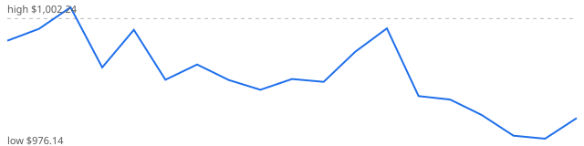

# Crypto paper bot (weekly trend)

Paper money only. Prices through **2026-10-30** (daily close, UTC). Checks daily, trades only on Sunday's close if the trend votes changed. Runs free on GitHub Actions.

| Paper account | Since start | From its high | Worst drawdown | In coins | Status |
|---|---|---|---|---|---|
| $962.99 | -3.70% | -3.9% | -3.9% | $367.39 (38%) | running |

## Trend votes (5 per coin)

| Coin | Price | 100d | 150d | 200d | 250d | 12-month | Target in coin |
|---|---|---|---|---|---|---|---|
| BTCUSD | $77,204.30 | yes | yes | yes | yes | no | 40% of its half |
| ETHUSD | $2,241.37 | no | yes | yes | yes | no | 40% of its half |

Expectancy (average profit/loss per sell, fees included): n/a (no sells yet)

## Last 10 trades

| Day | Coin | Bought (+) / sold (−) | Price | Why |
|---|---|---|---|---|
| 2026-10-09 | ETHUSD | $200.00 | $2,485.34 | 4/5 trend votes |
| 2026-10-09 | BTCUSD | $200.00 | $82,559.40 | 4/5 trend votes |

Prices from Kraken. Costs modelled at Webull's ~1.1% per buy or sell.
Stop it: set `"kill": true` in `paperbot/control.json` and commit. Backtest: `python -m paperbot.backtest`.
